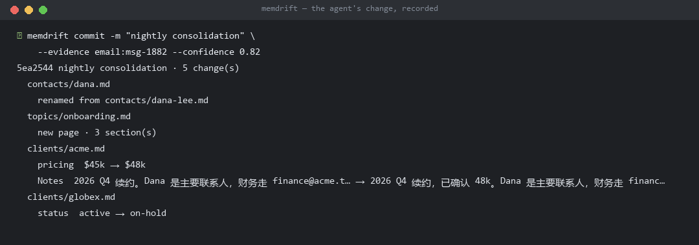
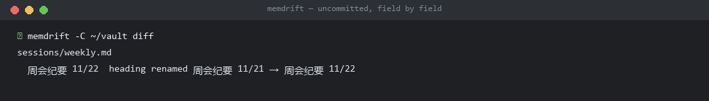
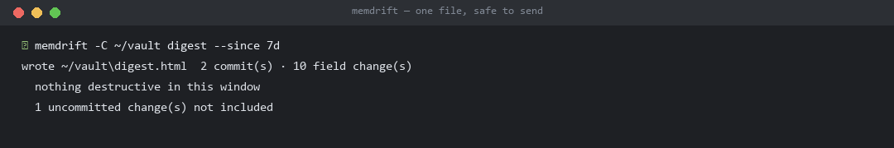
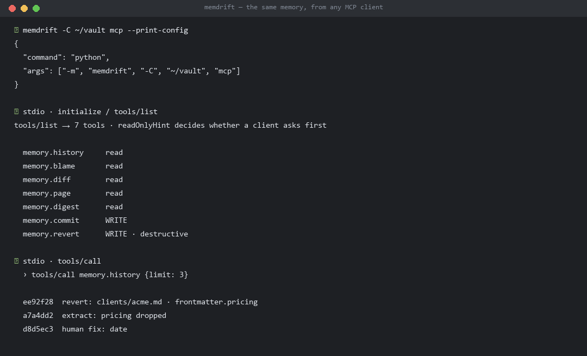
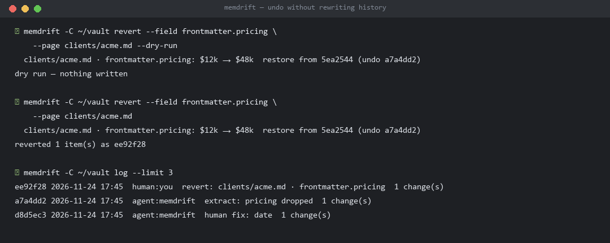
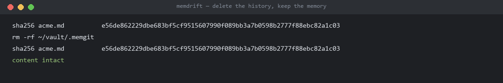
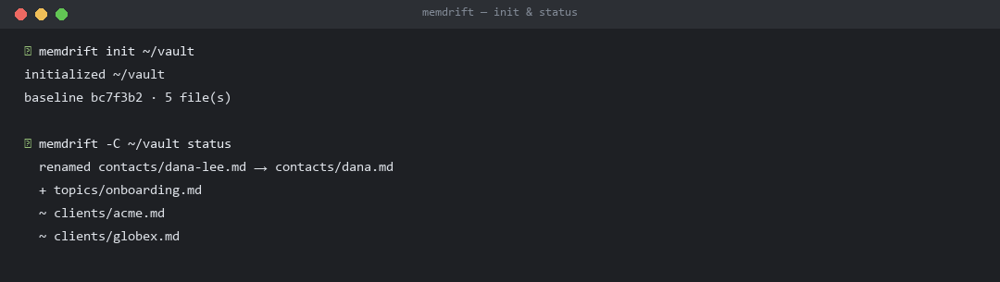

# memdrift

**Version control for agent memory.** See what your agent changed about you — field by field, with the evidence — and roll it back.

Your agent edits a dozen memory files overnight. You wake up and have no idea what moved. memdrift watches the directory, and tells you *the client's quote went from $45k to $48k, because of this email* — not "line 7 changed".

```bash
memdrift init ~/.basic-memory
memdrift -C ~/.basic-memory watch        # every burst of writes becomes one commit

# next morning
memdrift -C ~/.basic-memory log --since 1d
memdrift -C ~/.basic-memory blame clients/acme.md
```

This is a nightly consolidation, recorded:



And this is asking where the new price came from:


## The problem

Agent memory moved to files: `basic-memory`, `iwe`, Linger's wiki, Obsidian vaults, `CLAUDE.md`. That fixed *writing* — you can read and edit what the agent remembers. It did not fix *changing*:

| Gap | What it looks like |
|---|---|
| **Invisible** | Linger rewrites twelve wiki pages at 00:00. You wake up with no idea what moved. |
| **Unauditable** | The agent says "you told me $48k". You cannot check which message that came from. |
| **Irreversible** | One bad extraction poisons the page. Your only tool is a manual delete. |
| **Per-system** | `CLAUDE.md`, Cursor rules and your vault all accumulate facts about you, and disagree. |

`git diff` does not help. It tells you line 42 changed; it cannot tell you *the client's quote went from $45k to $48k*. memdrift stores changes as **structured fields**, not text diffs.

Add `--json` to any command to get the same information as data:

```json
{
  "path": "clients/acme.md",
  "op": "modify",
  "field": "frontmatter.pricing",
  "before": "$45k",
  "after": "$48k",
  "section": null,
  "change_ratio": 0.125
}
```

Renaming a heading is one change, not a delete plus an add:



## What it is

A layer that sits **beside** your memory directory and only records how it changed.

| Layer | Who owns it | memdrift |
|---|---|---|
| Fact extraction | Hindsight / mem0 | not our job |
| Storage & retrieval | basic-memory / iwe / any vault | **untouched** |
| Change history | — | **here** |
| Presentation | your product's UI | CLI, digest HTML, local UI |

**Not** a memory system, not a vector store, not a wiki editor, not a replacement for git.

### Where you actually look at it

A terminal is a bad place to read your own biography. Two views, one data source:

**`memdrift digest`** writes a single `.html` — inline CSS, no fonts to download, no analytics, no `http://` anywhere. Double-click it, or mail it. It is safe to send because sending it is *the point*:



**`memdrift serve`** opens a read-only local UI when you want to dig around instead of read a report.

```bash
memdrift -C ~/vault digest --since 1d -o morning.html
memdrift -C ~/vault serve --open
```

Both read the same redacted event stream, so they cannot disagree, and neither can forget to redact.

### And from inside your editor

Your agent already reads that memory directory. `memdrift mcp` puts the *history* next to it, so the agent can answer "did you change my prices?" with a commit id instead of a guess:



Seven tools, named so a model can tell them apart:

| Tool | | What it answers |
|---|---|---|
| `memory.history` | read | what happened recently, optionally for one page |
| `memory.blame` | read | which commit last touched each field, and the evidence behind it |
| `memory.diff` | read | field-level diff between two commits |
| `memory.page` | read | a page as it stood at a given commit |
| `memory.digest` | read | a window of changes as structured events, with risk flags |
| `memory.commit` | **write** | snapshot the working tree, with a required message |
| `memory.revert` | **write** | undo by committing the inverse |

The read tools carry `readOnlyHint: true`, so a client that honours annotations runs them silently and stops to ask before the two writers — no client-side code on your part. The names are dotted (`memory.history`) because that is what reads as one family to a model; some providers reject dots in name fields, so those get the flattened `memory_history` form on the wire only.

Wire it up:

```bash
memdrift -C ~/vault mcp --print-config   # paste the JSON into your client
memdrift -C ~/vault mcp                  # or run the server yourself
```

stdout is the protocol, so the server prints nothing else there — the banner goes to stderr. Both newline-delimited JSON and `Content-Length` framing are accepted, because clients disagree about which is "the" transport.

## Undo, without rewriting history

The failure this project exists for: an agent ingests a bad email, and `pricing: "$45k"` becomes `"$12k"`. Three granularities, all of them **append-only** — a revert is a new commit that undoes an old one, never an edit of the past:

```bash
memdrift -C ~/vault revert --field frontmatter.pricing --page clients/acme.md
memdrift -C ~/vault revert --page clients/acme.md --commit 9f2c1ab
memdrift -C ~/vault revert --commit 9f2c1ab          # undo everything that commit did
```



Look at the last three lines of that image: `revert:` is commit three, `extract: pricing dropped` is still commit two, unchanged. `blame` still points at the commit that introduced the bad value — it now *also* points at the commit that took it back out. Rewriting would make the log lie, which is the one thing a tool for "what did my agent do to me" cannot afford.

Two details that took a bug each to get right:

- **YAML quoting survives.** Restoring `"$48k"` writes `"$48k"`, not `$48k`. Both parse the same, but only one keeps a one-field revert from showing up as a whole-file diff.
- **Line endings survive.** On Windows, `Path.write_text` turns every `\n` into `\r\n`. Reading and writing with `newline=""` makes a page revert return a file that is **byte-identical** to the snapshot — verified by sha256, not by eye.

`--dry-run` prints the plan and writes nothing. The MCP tool defaults to `dry_run: true` for the same reason.

## Quickstart

```bash
pip install -e .
memdrift init ~/notes
memdrift -C ~/notes commit -m "manual fix" --evidence email:msg-1882
memdrift -C ~/notes blame clients/acme.md
```

`init` takes a baseline snapshot of every `.md` file it finds and never touches your files again.

`watch` is the intended mode — start it once, and every burst of agent writes lands as one commit:


### Why this is safe to try

Delete `.memgit/` and your memory is exactly as it was — history is lost, content is not. That invariant is tested, and re-checked every time this README's screenshots are regenerated:



It is the only reason to point a tool at a directory you care about, so it is the one thing the tool refuses to get wrong.

`init` and `status` look like this:



## Commands

| Command | What it does |
|---|---|
| `memdrift init <dir>` | Create `.memgit/`, write `config.toml`, baseline commit |
| `memdrift -C <dir> watch` | Watch for writes, merge a burst into one commit after 5s of quiet |
| `memdrift -C <dir> commit -m <msg> --evidence <ref>` | Manual commit with provenance |
| `memdrift -C <dir> log [--page p] [--since 7d]` | History, newest first |
| `memdrift -C <dir> diff [a] [b]` | Working tree vs HEAD, working tree vs one commit, or two snapshots |
| `memdrift -C <dir> show [commit]` | What one commit changed, with its evidence |
| `memdrift -C <dir> blame <page>` | Per-field: which commit last changed it, with evidence |
| `memdrift -C <dir> status` | Uncommitted changes |
| `memdrift -C <dir> digest [--since 1d] [--no-quote] [-o file]` | Self-contained HTML report, redacted by default |
| `memdrift -C <dir> serve [--port 7787] [--open]` | Read-only local UI on 127.0.0.1, token in the URL |
| `memdrift -C <dir> revert [--field f] [--page p] [--commit c] [--dry-run]` | Undo as a new commit; history is never rewritten |
| `memdrift -C <dir> mcp [--print-config] [--no-quote]` | Serve this directory over MCP (stdio) |
| `memdrift -C <dir> index --rebuild` | Rebuild the SQLite index from commit files |

Add `--json` to `log`, `diff`, `show`, `blame`, `status`, `commit`, `revert` for machine output.

## Sharing it without leaking it

A memory directory is a biography. The moment you paste a digest into a group chat you have published it, so the defaults are built around that:

| Risk | Default behaviour |
|---|---|
| **Machine paths** | `C:\Users\alice\vault\a.md` → `~/clients/a.md`. The root is stripped everywhere: change lists, evidence refs, MCP tool output. A path that is *not* under the root keeps only its last two segments, so `AppData/Local/...` never survives. |
| **Pasted paths inside values** | A path in the middle of a sentence is redacted too, not just one at position 0. Values are stored as 72-char previews, so a path cut mid-directory is replaced wholesale rather than half-guessed. |
| **Verbatim quotes** | Truncated to 120 chars with a `…`. `--no-quote` keeps the reference (`email:msg-1882`) and drops the text. |
| **Private pages** | `private: true` in frontmatter removes the page *and every evidence entry pointing at it* — otherwise the leak just moves one hop. `memory.page` refuses such a page outright. |
| **Escaping** | All memory text is HTML-escaped; a page whose title is `<script>` renders as text. |
| **`serve` binding** | Loopback only. `--host 0.0.0.0` is refused by design, not by config. |
| **CSRF / DNS rebinding** | A per-process random token in the URL, plus a `Host` whitelist and an `Origin` match. A page that rebinds `evil.test` to 127.0.0.1 gets 403 even with a valid token. |
| **MCP writes** | The two writer tools are annotated `readOnlyHint: false`; `memory.revert` also declares `destructiveHint` and defaults to `dry_run: true`. |
| **MCP path traversal** | A `page` argument is resolved and rejected if it leaves the memory root — an agent cannot ask for `../../etc/passwd`. |

`--no-redact` exists and prints a warning. Use it only for a file that never leaves the machine.

What is **not** encrypted: `.memgit/` objects are zlib-compressed, not encrypted. Anyone who can read the directory can read the history. If that is your threat model, put the directory on an encrypted volume — pretending to invent a key-management scheme here would be worse.

## How a change is stored

A commit is a snapshot plus **structured** changes:

```json
{
  "id": "sha256:9f2c…",
  "parent": "sha256:1a7b…",
  "ts": "2026-11-22T00:00:12+08:00",
  "author": { "type": "agent", "name": "linger-dreaming" },
  "message": "nightly consolidation",
  "changes": [
    {
      "path": "clients/acme.md",
      "op": "modify",
      "field": "frontmatter.pricing",
      "before": "$45k",
      "after": "$48k",
      "section": null,
      "change_ratio": 0.125
    }
  ],
  "evidence": [
    { "kind": "email", "ref": "msg-1882", "quote": "we can do 48k for 200 seats" }
  ],
  "confidence": 0.82
}
```

Field paths are `frontmatter.<dotted.key>`, `section:<heading>`, or `body`. `op` is one of `add · modify · delete · rename`. Unknown fields are ignored by readers, so the format can grow.

When heading structure collapses (a page gets rewritten wholesale), attribution degrades to `body` and is flagged `low_precision: true` rather than pretending to be precise. Renaming a heading is recorded as one `rename` with the old and new text, not as a delete plus an add.

## Layout

```
<memory-dir>/
  .memgit/
    config.toml
    objects/ab/cdef…      # zlib, sha256-addressed
    commits/ab/cdef….json # one json per commit
    refs/head
    index.sqlite          # rebuildable cache
```

Code: `repo` (objects, refs) · `differ` (field-level diff) · `events` (the one stream) · `security` (redaction) · `digest` / `server` (the two views) · `revert` (undo) · `rpc` / `mcp` (the agent channel).

## Development

```bash
git clone git@github.com:x-tian-lab/memdrift.git && cd memdrift
python -m venv .venv && .venv/bin/pip install -e ".[docs]"
.venv/bin/pytest -q
.venv/bin/python scripts/render_terminal_shots.py   # regenerates docs/assets
.venv/bin/python scripts/smoke_serve.py             # drives serve over real HTTP
```

Every screenshot in this README is produced by that last command: it builds a demo vault, runs the real binary, and fails loudly if any command does. There is no hand-edited output anywhere in the images.

## Status

v0.1, week 3 of the plan: `init · watch · commit · log · diff · show · blame · status · digest · serve · revert · mcp` all work on a real directory, and 174 tests pass. Nothing here is stable enough to embed yet.

Known gap: `.memgit/refs/head` is a single file with no lock, so it is **one writer, many readers**. Two agents committing at the same instant can lose a commit. `watch` is the intended path — it serialises a burst into one commit — but true concurrent writers need a lock, and faking one would be worse than saying so.

Requirements: Python 3.11+, macOS / Linux / Windows. Three dependencies: `click`, `python-frontmatter`, `watchdog`. The MCP server is stdlib-only — it does not need the official SDK, and a JSON-RPC layer we can read in one sitting beats a dependency that breaks in someone else's editor.

Local only. No network calls, ever: `serve` binds to loopback, `mcp` speaks over stdin/stdout.

## License

MIT.
