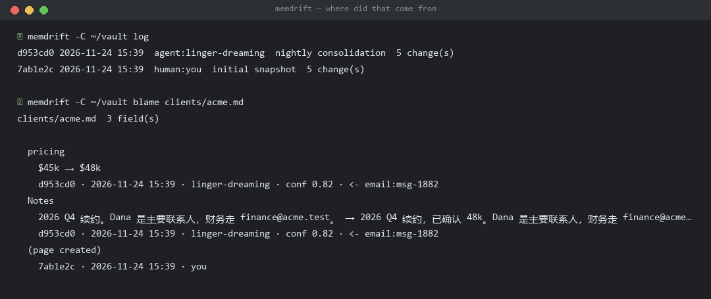
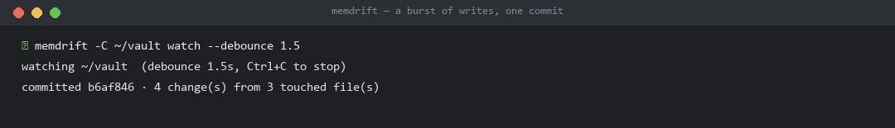

# memdrift

**Version control for agent memory.** See what your agent changed about you — field by field, with the evidence — and roll it back.

Your agent edits a dozen memory files overnight. You wake up and have no idea what moved. memdrift watches the directory, and tells you *the client's quote went from $45k to $48k, because of this email* — not "line 7 changed".

```bash
memdrift init ~/.basic-memory
memdrift -C ~/.basic-memory watch        # every burst of writes becomes one commit

# next morning
memdrift -C ~/.basic-memory log --since 1d
memdrift -C ~/.basic-memory blame clients/acme.md
```

This is a nightly consolidation, recorded:


And this is asking where the new price came from:



## The problem

Agent memory moved to files: `basic-memory`, `iwe`, Linger's wiki, Obsidian vaults, `CLAUDE.md`. That fixed *writing* — you can read and edit what the agent remembers. It did not fix *changing*:

| Gap | What it looks like |
|---|---|
| **Invisible** | Linger rewrites twelve wiki pages at 00:00. You wake up with no idea what moved. |
| **Unauditable** | The agent says "you told me $48k". You cannot check which message that came from. |
| **Irreversible** | One bad extraction poisons the page. Your only tool is a manual delete. |
| **Per-system** | `CLAUDE.md`, Cursor rules and your vault all accumulate facts about you, and disagree. |

`git diff` does not help. It tells you line 42 changed; it cannot tell you *the client's quote went from $45k to $48k*. memdrift stores changes as **structured fields**, not text diffs.

Add `--json` to any command to get the same information as data:

```json
{
  "path": "clients/acme.md",
  "op": "modify",
  "field": "frontmatter.pricing",
  "before": "$45k",
  "after": "$48k",
  "section": null,
  "change_ratio": 0.125
}
```

Renaming a heading is one change, not a delete plus an add:


## What it is

A layer that sits **beside** your memory directory and only records how it changed.

| Layer | Who owns it | memdrift |
|---|---|---|
| Fact extraction | Hindsight / mem0 | not our job |
| Storage & retrieval | basic-memory / iwe / any vault | **untouched** |
| Change history | — | **here** |
| Presentation | your product's UI | CLI today, digest + MCP next |

**Not** a memory system, not a vector store, not a wiki editor, not a replacement for git.

## Quickstart

```bash
pip install -e .
memdrift init ~/notes
memdrift -C ~/notes commit -m "manual fix" --evidence email:msg-1882
memdrift -C ~/notes blame clients/acme.md
```

`init` takes a baseline snapshot of every `.md` file it finds and never touches your files again.

`watch` is the intended mode — start it once, and every burst of agent writes lands as one commit:



### Why this is safe to try

Delete `.memgit/` and your memory is exactly as it was — history is lost, content is not. That invariant is tested, and re-checked every time this README's screenshots are regenerated:


It is the only reason to point a tool at a directory you care about, so it is the one thing the tool refuses to get wrong.

`init` and `status` look like this:


## Commands

| Command | What it does |
|---|---|
| `memdrift init <dir>` | Create `.memgit/`, write `config.toml`, baseline commit |
| `memdrift -C <dir> watch` | Watch for writes, merge a burst into one commit after 5s of quiet |
| `memdrift -C <dir> commit -m <msg> --evidence <ref>` | Manual commit with provenance |
| `memdrift -C <dir> log [--page p] [--since 7d]` | History, newest first |
| `memdrift -C <dir> diff [a] [b]` | Working tree vs HEAD, working tree vs one commit, or two snapshots |
| `memdrift -C <dir> show [commit]` | What one commit changed, with its evidence |
| `memdrift -C <dir> blame <page>` | Per-field: which commit last changed it, with evidence |
| `memdrift -C <dir> status` | Uncommitted changes |
| `memdrift -C <dir> index --rebuild` | Rebuild the SQLite index from commit files |

Add `--json` to `log`, `diff`, `show`, `blame`, `status`, `commit` for machine output.

## How a change is stored

A commit is a snapshot plus **structured** changes:

```json
{
  "id": "sha256:9f2c…",
  "parent": "sha256:1a7b…",
  "ts": "2026-11-22T00:00:12+08:00",
  "author": { "type": "agent", "name": "linger-dreaming" },
  "message": "nightly consolidation",
  "changes": [
    {
      "path": "clients/acme.md",
      "op": "modify",
      "field": "frontmatter.pricing",
      "before": "$45k",
      "after": "$48k",
      "section": null,
      "change_ratio": 0.125
    }
  ],
  "evidence": [
    { "kind": "email", "ref": "msg-1882", "quote": "we can do 48k for 200 seats" }
  ],
  "confidence": 0.82
}
```

Field paths are `frontmatter.<dotted.key>`, `section:<heading>`, or `body`. `op` is one of `add · modify · delete · rename`. Unknown fields are ignored by readers, so the format can grow.

When heading structure collapses (a page gets rewritten wholesale), attribution degrades to `body` and is flagged `low_precision: true` rather than pretending to be precise. Renaming a heading is recorded as one `rename` with the old and new text, not as a delete plus an add.

## Layout

```
<memory-dir>/
  .memgit/
    config.toml
    objects/ab/cdef…      # zlib, sha256-addressed
    commits/ab/cdef….json # one json per commit
    refs/head
    index.sqlite          # rebuildable cache
```

## Development

```bash
git clone git@github.com:x-tian-lab/memdrift.git && cd memdrift
python -m venv .venv && .venv/bin/pip install -e ".[docs]"
.venv/bin/pytest -q
.venv/bin/python scripts/render_terminal_shots.py   # regenerates docs/assets
```

Every screenshot in this README is produced by that last command: it builds a demo vault, runs the real binary, and fails loudly if any command does. There is no hand-edited output anywhere in the images.

## Status

v0.1, week 1 of the plan: `init · watch · commit · log · diff · show · blame · status` work on a real directory. `revert`, the daily digest HTML and the MCP server are next. Nothing here is stable enough to embed yet.

Requirements: Python 3.11+, macOS / Linux / Windows. Three dependencies: `click`, `python-frontmatter`, `watchdog` (and `jinja2`, once the digest lands).

Local only. No network calls, ever.

## License

MIT.
